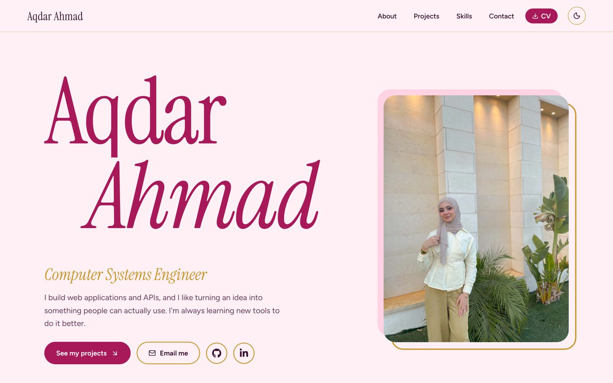
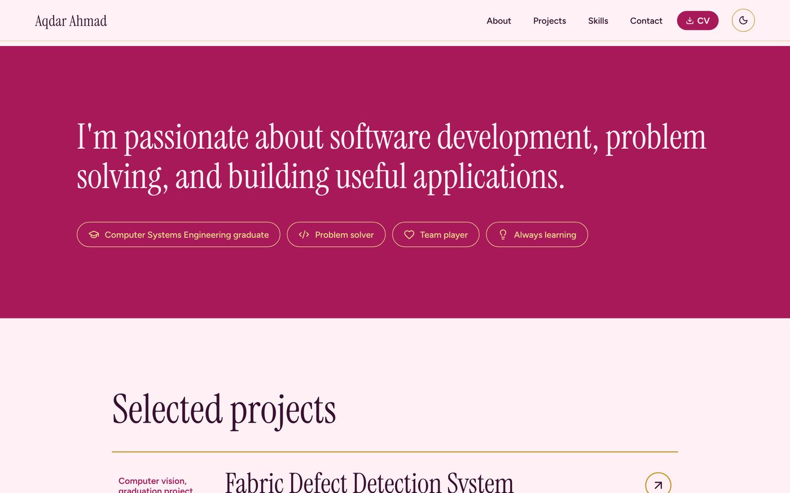
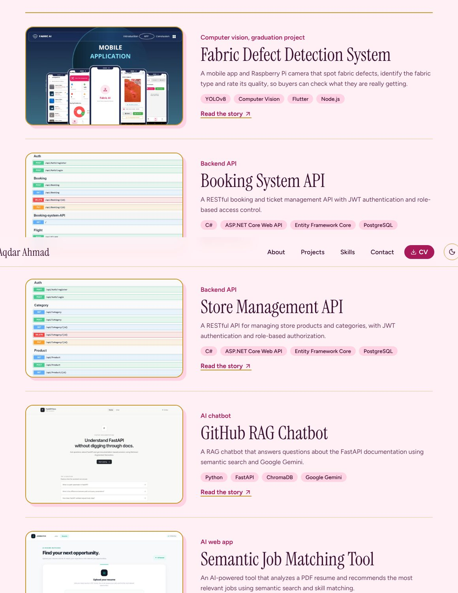
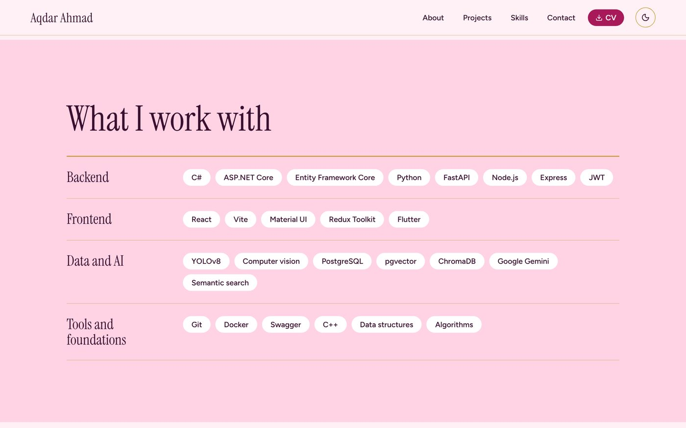
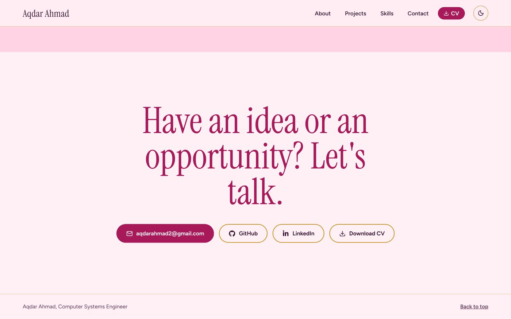
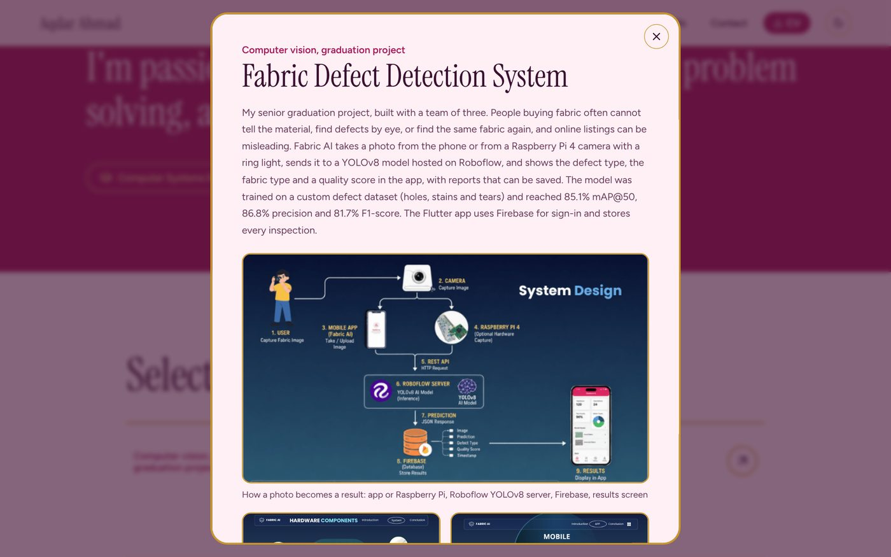
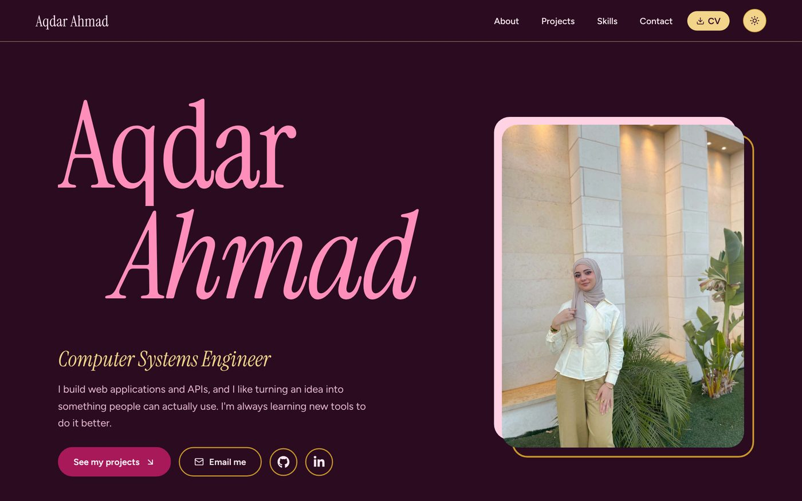
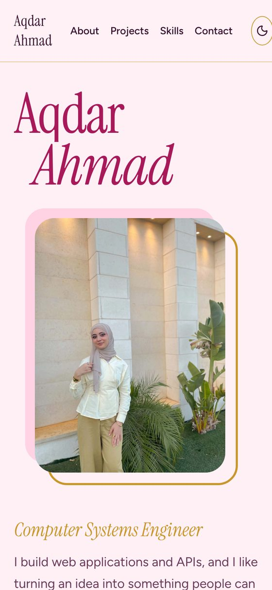

<div align="center">

# Aqdar Ahmad · Portfolio

**Computer Systems Engineer** building web applications, APIs and AI-powered tools.

[](https://portfolio-kq37.onrender.com)

[](https://react.dev)
[](https://vite.dev)
[](https://render.com)



</div>

## About

A personal portfolio that presents my work as a software engineer: backend APIs, a computer-vision graduation project, an AI job-matching tool and a full-stack quiz platform. The design is bold and modern, with a pastel pink and gold palette and an editorial serif for headings.

## Preview

| About | Projects |
|---|---|
|  |  |
| **Skills** | **Contact** |
|  |  |

### Project details with image gallery

Every project opens in a modal with the full story, tech stack, links and, where available, a gallery of screenshots (the Fabric project includes the system design, hardware, app screens and test cases).



### Dark mode and mobile

<p>
  
  
</p>

## Features

- Responsive layout that works from phones to wide desktops
- Light and dark theme with a one-click toggle
- Project modal with details, tech tags, live demo and GitHub links, plus an image gallery
- Skills grouped by area (backend, frontend, data and AI, tools)
- Downloadable CV and direct links to GitHub, LinkedIn and email
- Accessible markup: labelled controls, keyboard-friendly navigation, readable contrast

## Projects shown

| Project | What it is | Stack |
|---|---|---|
| [Fabric Defect Detection System](https://github.com/aqdarahmad/Fabric-AI) | Graduation project: finds fabric defects, identifies fabric type and rates quality (85.1% mAP@50) | YOLOv8, Flutter, Node.js, Raspberry Pi |
| [Booking System API](https://github.com/aqdarahmad/booking-system-api) | Booking and tickets API with JWT and roles | ASP.NET Core, EF Core, PostgreSQL |
| [Store Management API](https://github.com/aqdarahmad/Store-Management) | Products and categories API with role-based access | ASP.NET Core, JWT, Swagger |
| [GitHub RAG Chatbot](https://github.com/aqdarahmad/github-rag-chatbot) | Chat with any GitHub repository | Python, FastAPI, ChromaDB, Gemini |
| [Semantic Job Matching Tool](https://github.com/aqdarahmad/semantic-search-tool) | Matches a candidate profile to jobs by meaning | Python, pgvector, Gemini |
| [QuizLoom](https://github.com/aqdarahmad/Quiz-Loom) | Quiz platform with student and admin dashboards | React, Express, PostgreSQL |
| [Lost & Found App](https://github.com/aqdarahmad/lose-found2-master) | App to post, comment on and save lost and found items | Flutter, Node.js, PostgreSQL |
| [Problem Solving](https://github.com/aqdarahmad/competitive-programming) | Algorithms and data structures practice | C++ |

## Tech stack

- **Framework:** React 19 + Vite 8
- **Styling:** plain CSS with CSS variables (theme tokens, dark mode)
- **Fonts:** Instrument Serif and Figtree via `@fontsource`
- **Icons:** lucide-react, react-icons

## Project structure

```
src/
  components/   Navbar, Hero, About, Projects, ProjectModal, Skills, Contact, Footer
  data/         projects.js (projects, gallery images, skill groups)
  App.css       layout and component styles
  index.css     theme variables and base styles
public/         CV, favicon and project images
docs/           screenshots used in this README
```

To add or edit a project, change only `src/data/projects.js`. Put images in `public/` and list them in the project's `gallery`.

## Run locally

```bash
git clone https://github.com/aqdarahmad/portfolio.git
cd portfolio
npm install
npm run dev        # http://localhost:5173
```

```bash
npm run build      # production build in dist/
npm run start      # serve the build on $PORT (used by Render)
```

## Deploy on Render

- **Build command:** `npm install && npm run build`
- **Start command:** `npm start`

A Render **Static Site** (publish directory `dist`) also works and is faster and free of cold starts.

## Contact

[LinkedIn](https://www.linkedin.com/in/aqdar-ahmad-b30832421) · [GitHub](https://github.com/aqdarahmad)
